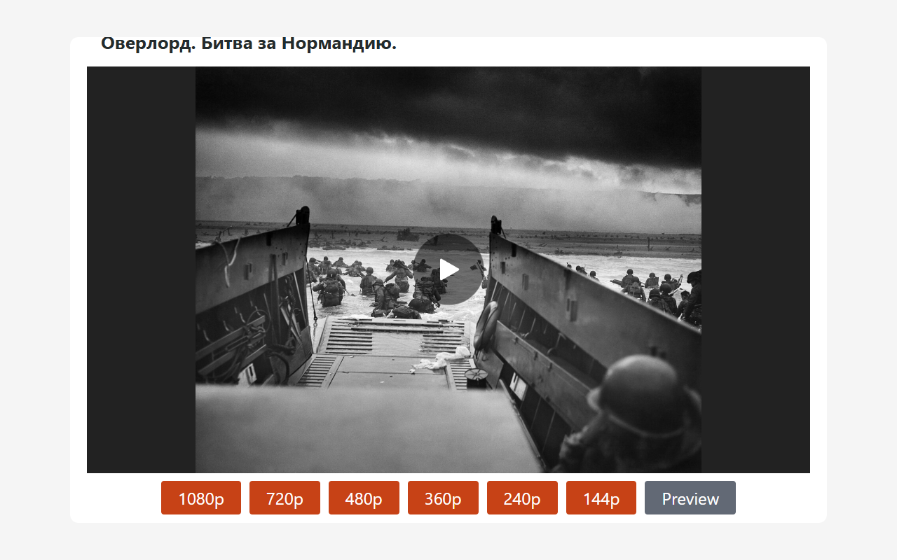

# More Boosty

**English** · [Русский](README.md) · [Download a release](https://github.com/WeslyG/more-boosty/releases) · [Changelog](CHANGELOG.md)

**Quality-specific Boosty video links and preview images, right below the player.**

More Boosty helps you save accessible videos to watch later.
Choose an available quality, open its link and save the file using your browser.



## Features

- Links for every available video quality, sorted from highest to lowest.
- A separate link to the preview image.
- Multiple videos in the same post.
- Players in individual posts, author feeds and media views.
- Videos in up to 300 recent messages from the selected dialog.
- Russian and English interface.

Restricted content requires a Boosty login and the appropriate access.
Save your own content or videos you have permission to download.

## Installation

1. Open [GitHub Releases](https://github.com/WeslyG/more-boosty/releases) and download
   `more-boosty-vX.Y.Z.zip` from the release you want.
2. Extract the archive to a separate folder.
3. Open `chrome://extensions` and enable **Developer mode**.
4. Select **Load unpacked** and choose that folder.
5. Reload your Boosty tab.

Use the extension ZIP attached to the release. GitHub's automatic “Source code” archives contain
the project sources and require a [build](#build-from-source).
If no release has been published yet, build from source as shown below.

## Usage

1. Open a Boosty post or dialog containing a video.
2. Read the notice below the player and select **Show video links**.
3. Choose a quality or **Preview**.
4. The link opens in a new tab. If the browser plays the video, use **Save video as…**
   from its context menu.

Links are requested separately for the selected post or dialog. A full page reload clears
the approval, so you need to select the button again.

## Data and privacy

Only after your action does More Boosty read the current Boosty session token and send it
to the Boosty API to obtain the selected content's links. The response may contain post text
or dialog messages; only video metadata is cached.

Processing and caching are temporary, in memory. The developer does not receive your token
or post content. Opening a video link connects your browser to the media host supplied by Boosty.
There is no advertising or analytics.

[Privacy policy](PRIVACY.md) · [Политика конфиденциальности](PRIVACY.ru.md)

## Build from source

Use Node.js 24 and npm; the minimum supported Node.js version is 22.13.

```sh
git clone https://github.com/WeslyG/more-boosty.git
cd more-boosty
npm ci
npm test
npm run build
```

Load the `distribution/` folder with **Load unpacked**.
`npm run release` also creates the verified ZIP, a versioned archive, a SHA-256 checksum
and release notes in `artifacts/`.

## Development and support

[Contributing and commit conventions](CONTRIBUTING.md) · [AGENTS.md](AGENTS.md) ·
[Chrome Web Store publishing](docs/publishing.en.md)

Report bugs in [Issues](https://github.com/WeslyG/more-boosty/issues).
Include the page and reproduction steps; never attach tokens, private messages or signed media URLs.

More Boosty is independent and is not affiliated with Boosty. The platform's markup and API may change.
License: [MIT](LICENSE).
