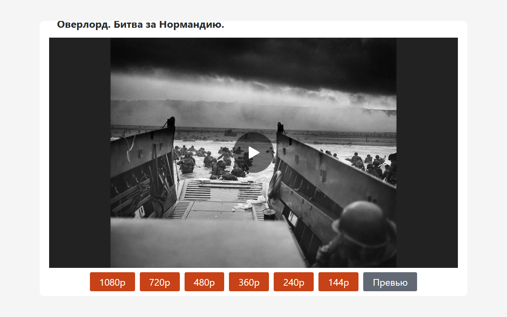

# More Boosty

[English](README.en.md) · **Русский** · [Скачать релиз](https://github.com/WeslyG/more-boosty/releases) · [Что изменилось](CHANGELOG.md)

**Ссылки на видео Boosty в нужном качестве и на их превью — прямо под плеером.**

More Boosty помогает сохранить доступное вам видео для просмотра позже.
Расширение показывает все доступные разрешения: выбираете качество, открываете ссылку и сохраняете файл средствами браузера.



## Что умеет

- Показывает ссылки во всех доступных качествах, от большего к меньшему.
- Добавляет отдельную ссылку на превью.
- Работает с несколькими видео в одном посте.
- Находит плееры в постах, ленте автора и просмотре медиа.
- Поддерживает видео в последних 300 сообщениях выбранного диалога.
- Имеет русский и английский интерфейс.

Для закрытого контента нужны вход в Boosty и соответствующий доступ.
Сохраняйте свои материалы или видео, на скачивание которых у вас есть разрешение.

## Установка

Установите [More Boosty из Chrome Web Store](https://chromewebstore.google.com/detail/more-boosty/cbdimpbiobgfcfhnjjnnmmbojdijlcim), затем обновите вкладку Boosty.

### Установка вручную

1. Откройте [GitHub Releases](https://github.com/WeslyG/more-boosty/releases) и скачайте
   `more-boosty-vX.Y.Z.zip` из нужного выпуска.
2. Распакуйте архив в отдельную папку.
3. Откройте `chrome://extensions` и включите **Режим разработчика**.
4. Нажмите **Загрузить распакованное расширение** и выберите эту папку.
5. Обновите вкладку Boosty.

ZIP расширения находится в assets релиза. Автоматические архивы GitHub «Source code» содержат исходники;
для них нужна [сборка](#сборка-из-исходников).
Если релизов пока нет, используйте установку из исходников ниже.

## Как пользоваться

1. Откройте пост или диалог Boosty с видео.
2. Прочитайте пояснение под плеером и нажмите **Показать ссылки на видео**.
3. Выберите разрешение или **Превью**.
4. Ссылка откроется в новой вкладке. Если браузер воспроизводит видео, сохраните его через меню
   **Сохранить видео как…**.

Ссылки запрашиваются отдельно для выбранного поста или диалога. После полной перезагрузки страницы
нужно снова нажать кнопку.

## Данные и приватность

Только после нажатия More Boosty читает токен текущей сессии Boosty и отправляет его API Boosty
для получения ссылок на выбранный контент. Ответ может содержать текст поста или сообщения диалога;
в кэше остаются только сведения о видео.

Обработка и кэширование временные, в памяти. Разработчик не получает токен или содержимое постов.
При открытии видео браузер обращается к медиасерверу, указанному Boosty.
Рекламы и аналитики нет.

[Политика конфиденциальности](PRIVACY.ru.md) · [Privacy policy](PRIVACY.md)

## Сборка из исходников

Нужны Node.js 24 и npm; минимальная версия Node.js — 22.13.

```sh
git clone https://github.com/WeslyG/more-boosty.git
cd more-boosty
npm ci
npm test
npm run build
```

Установите папку `distribution/` через **Загрузить распакованное расширение**.
Команда `npm run release` дополнительно создаёт проверенный ZIP, версионный архив, SHA-256
и заметки релиза в `artifacts/`.

## Разработка и поддержка

[Правила разработки и коммитов](CONTRIBUTING.md) · [AGENTS.md](AGENTS.md) ·
[Публикация в Chrome Web Store](docs/publishing.md)

Ошибку можно сообщить в [Issues](https://github.com/WeslyG/more-boosty/issues).
Опишите страницу и действия; не прикладывайте токены, приватные сообщения или подписанные ссылки на видео.

More Boosty — независимое расширение, не связанное с Boosty. Вёрстка и API платформы могут меняться.
Лицензия: [MIT](LICENSE).
